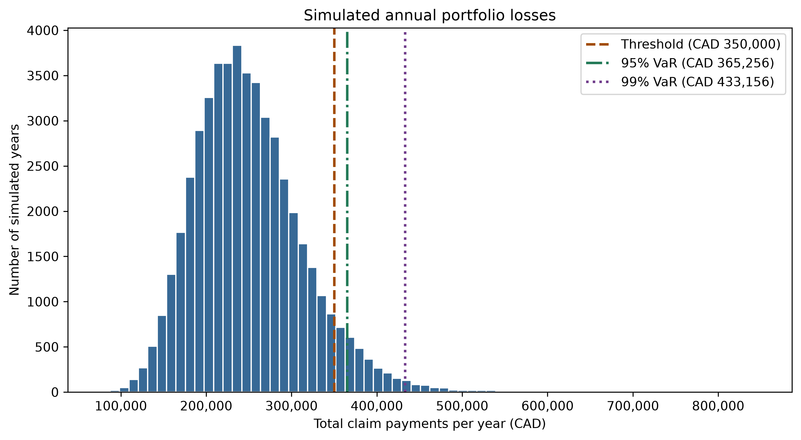
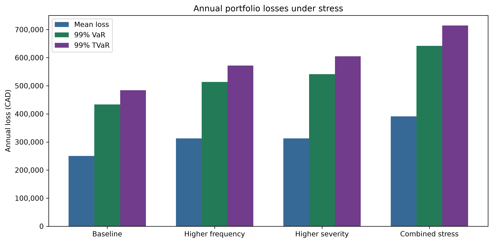

# Monte Carlo Insurance Risk Simulation

How much might an insurer pay in claims over one year, and how does the risk of a costly year change when claims become more frequent or more expensive?

This project simulates annual claim payments for one illustrative insurance portfolio. It checks the baseline simulation against a mathematical benchmark, measures tail risk, and compares three stress scenarios. All monetary amounts are in Canadian dollars (CAD).

## Key findings

- **Baseline.** Across 50,000 simulated years, the mean annual loss was **CAD 250,157**, compared with the analytical expectation of **CAD 250,000**. Annual losses exceeded CAD 350,000 in **6.96%** of simulated years.
- **Tail risk.** The baseline 99% Value at Risk (VaR) was **CAD 433,156**. The 99% Tail Value at Risk (TVaR), the average loss in the worst 1% of simulated years, was **CAD 483,911**.
- **Frequency versus severity.** Raising frequency by 25% or scaling claim severity by 25% gives the same analytical mean annual loss of **CAD 312,500**. The simulated 99% TVaR was higher under severity stress (**CAD 604,888**) than under frequency stress (**CAD 571,695**).
- **Combined stress.** Applying both increases raised the share of simulated years exceeding CAD 350,000 to **65.45%**.





## Model and assumptions

The baseline represents 1,000 policy-years at 0.05 expected claims per policy-year. The annual claim count \(N\) follows a Poisson distribution with mean 50. Individual claim payments \(X_i\) follow a lognormal distribution with a mean of CAD 5,000 and a standard deviation of CAD 7,500. Claim payments are independent of one another and of the claim count.

Annual loss is the sum of all payments in a year, \(L = \sum_{i=1}^{N} X_i\). A year with no claims has zero loss. The expected annual loss is \(E[N] \times E[X] = 50 \times 5{,}000 = 250{,}000\) CAD.

Each scenario uses 50,000 simulated years and random seed 42. The frequency stress increases the expected number of claims by 25%. The severity stress increases both the mean and standard deviation of claim payments by 25%, preserving their ratio. The combined stress applies both changes. The assumptions are illustrative, and the model covers claim payments only.

## Explore the notebooks

1. [Claim frequency and severity](notebooks/01_model_exploration.ipynb) shows the two distributions and compares simulated averages with the model assumptions.
2. [Annual loss simulation](notebooks/02_monte_carlo_simulation.ipynb) checks the simulated mean against the analytical benchmark and estimates 95% and 99% VaR and TVaR.
3. [Sensitivity analysis](notebooks/03_sensitivity_analysis.ipynb) compares the baseline with the frequency, severity, and combined stresses.

The notebooks share the simulation and risk calculations in [`src/simulation.py`](src/simulation.py). The [test suite](tests/test_simulation.py) checks sampling, reproducibility, annual loss aggregation, agreement with the analytical mean, hand-calculated risk metrics, and input validation.

## Reproduce the results

From the project root, use Python 3.11 to create a virtual environment and install the dependencies.

```bash
python3 -m venv .venv
source .venv/bin/activate
python -m pip install -r requirements.txt
python -m pytest tests/test_simulation.py -q
python -m jupyterlab
```

If `.venv` already exists, start with the activation command. In JupyterLab, open the notebooks in numerical order and run all cells in each. Notebooks 02 and 03 regenerate the PNGs in `figures/`.
